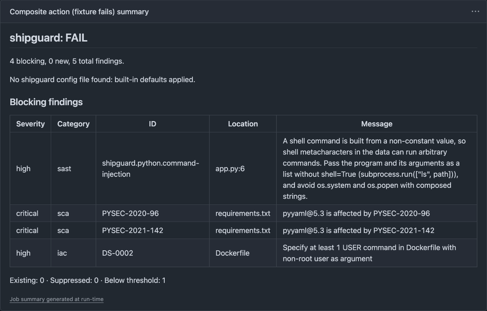
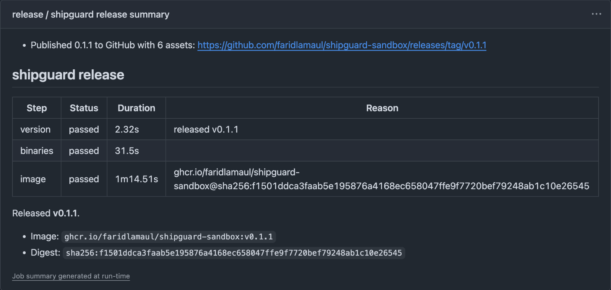

<p align="center">
  <picture>
    <source media="(prefers-color-scheme: dark)" srcset="docs/assets/logo-dark.svg">
    
  </picture>
</p>

<p align="center">
  <strong>Security scanning, build and test, and releases for your CI pipeline.</strong><br>
  One image for GitHub, GitLab and Bitbucket.
</p>

<p align="center">
  <a href="https://github.com/faridlamaul/shipguard/actions/workflows/ci.yml"></a>
  <a href="https://github.com/faridlamaul/shipguard/actions/workflows/release.yml"></a>
  <a href="https://github.com/faridlamaul/shipguard/releases/latest"></a>
  <a href="https://golang.org"></a>
  <a href="https://opensource.org/licenses/MIT"></a>
</p>

<p align="center">
  
</p>


**Scan, build and release from one container image, with one policy file.** shipguard is for teams that run CI on GitHub, GitLab or Bitbucket.

It scans with a policy gate (`shipguard scan`), builds and tests (`shipguard ci`) and releases a scanned, signed image (`shipguard release`).

- **Scan:** four scanners feed one policy file, `.shipguard.yaml`.
- **Gate:** on a pull request only the findings the PR introduces can fail it.
- **Build and test:** lint, test and build for Go, Node, Python, Ruby and Rust.
- **Release:** version, binaries and a signed image with provenance.

<details>
<summary><strong>Contents</strong></summary>

- [How it works](#how-it-works)
- [Status](#status)
- [Installation](#installation)
- [Quick start](#quick-start)
- [Screenshots](#screenshots)
- [Documentation](#documentation)
- [Exit codes](#exit-codes)
- [Legacy workflows](#legacy-workflows)
- [Contributing](#contributing)
- [Ownership](#ownership)
- [License](#license)

</details>

## How it works

shipguard runs four kinds of scan in one container image. It applies one policy file to the results and reports them to the platform you already use.

| Category | Scanner | Looks at |
|---|---|---|
| `secrets` | gitleaks | file contents, and git history on PR and scheduled scans |
| `sast` | opengrep with the curated rules in `rules/` | source code (Go, JS/TS, Python, Ruby, Rust) |
| `sca` | osv-scanner, and trivy for licenses | lockfiles and manifests |
| `iac` | trivy config | Dockerfile, Kubernetes, Helm, Terraform, CloudFormation, Compose |

On a pull request only the findings the PR introduces can fail the gate. On the default branch and on schedules everything above the threshold fails.

### How the gate is protected

- On a PR the policy is read from the base branch, so a PR cannot weaken its own gate. The summary warns when the PR changes `.shipguard.yaml`.
- Scanner ignore files, config files and inline suppressions (`.gitleaksignore`, `nosemgrep`, `.trivyignore` and so on) are ignored. Exceptions live in `.shipguard.yaml`, with a reason and an expiry date.
- Secret values are redacted in every output.

## Status

| Part | State |
|---|---|
| Go CLI (`scan`, `gate`, `report`, `run`) | done |
| `shipguard release`: version, binaries and a scanned, signed image, see [docs/release.md](docs/release.md) | CLI done |
| `shipguard ci`: lint, test and build for Go, Node, Python, Ruby and Rust on GitHub, GitLab and Bitbucket, see [docs/ci.md](docs/ci.md) | done |
| GitHub adapter (reusable workflow and composite action) | done |
| GitLab component (CI/CD Catalog) | released |
| Bitbucket pipe | released |
| Image `ghcr.io/faridlamaul/shipguard` (signed, with provenance) | released |

The docs write `vX.Y.Z` for the release you pin (GitLab: `X.Y.Z`, no `v`). See [Releases](https://github.com/faridlamaul/shipguard/releases) for the latest version.

## Installation

There is nothing to install. You use the image `ghcr.io/faridlamaul/shipguard` through the adapter for your platform:

- GitHub: [reusable workflow and composite action](docs/github.md)
- GitLab: [CI/CD component](docs/gitlab.md)
- Bitbucket: [pipe](docs/bitbucket.md)

## Quick start

### Scan on GitHub

Add `.github/workflows/security.yml`:

```yaml
name: Security

on:
  pull_request:
  push:
    branches: [main]
  schedule:
    - cron: "17 3 * * 1"

jobs:
  security:
    uses: faridlamaul/shipguard/.github/workflows/scan.yml@vX.Y.Z
    permissions: { contents: read, security-events: write, actions: read }
    with:
      scanners: all
      mode: enforce
      config: .shipguard.yaml
```

The defaults need no config file. To change them, add a `.shipguard.yaml` in its own pull request first; see [Configuration](docs/configuration.md#pull-requests-the-policy-comes-from-the-base).

```yaml shipguard-config
version: 1
mode: enforce
paths:
  exclude: ["vendor/", "**/testdata/**"]
exceptions:
  - id: CVE-2026-1234
    reason: "Not reachable; waiting for upstream v2.3"
    expires: 2026-12-31
```

### Lint, test and build

`shipguard ci` detects the language (Go, Node, Python, Ruby, Rust) and runs pinned lint, test and build steps. Add `.github/workflows/ci.yml`:

```yaml
name: CI
on:
  pull_request:
  push:
    branches: [main]
permissions:
  contents: read
jobs:
  ci:
    uses: faridlamaul/shipguard/.github/workflows/build-test.yml@vX.Y.Z
```

[docs/ci.md](docs/ci.md) has the GitLab and Bitbucket snippets, the defaults per language, the `ci:` config, outputs and exit codes. This replaces the [legacy workflows](#legacy-workflows) `go-ci`, `node-ci` and `python-ci`.

## Screenshots

A pull request whose scan blocks. The job summary lists every blocking finding.

<p align="center">
  
</p>

A release from `release-artifacts.yml`. The summary shows the version, the binaries and the signed image with its digest.

<p align="center">
  
</p>

## Documentation

| Page | Contents |
|---|---|
| [docs/ci.md](docs/ci.md) | `shipguard ci`: usage per platform, defaults per language, `ci:` config, outputs, exit codes, security |
| [docs/release.md](docs/release.md) | `shipguard release`: steps, `release:` config, dry run, outputs, exit codes, verifying releases |
| [docs/configuration.md](docs/configuration.md) | Every `.shipguard.yaml` key, defaults, exceptions, PR policy, ignored scanner config, exit codes, environment variables |
| [docs/github.md](docs/github.md) | Inputs, permissions, hardening, tier notes |
| [docs/gitlab.md](docs/gitlab.md) | Component inputs, `include: remote` with integrity, hardening |
| [docs/bitbucket.md](docs/bitbucket.md) | Pipe variables, schedules, Code Insights, hardening |
| [examples/](examples/) | Ready-to-copy pipeline files |

## Exit codes

| Code | Meaning |
|---|---|
| `0` | Pass, or `audit` mode with findings |
| `1` | Policy failure: findings above the threshold |
| `2` | Tool or configuration error (shipguard fails closed) |

## Legacy workflows

This repository still publishes the reusable GitHub Actions workflows (`workflow_call`) it started with. They are separate from shipguard and deprecated. They will be removed in the next major release.

| Legacy workflow | Replacement |
|---|---|
| `go-ci`, `node-ci`, `python-ci` | `shipguard ci` ([docs/ci.md](docs/ci.md)) |
| `semantic-release`, `go-release`, `docker-build` | `release-artifacts.yml` ([docs/release.md](docs/release.md)) |

<details>
<summary><strong>Workflows and usage examples</strong></summary>

The examples use `@vX.Y.Z` for the release you pin. Each workflow is at `.github/workflows/<name>.yml`.

| Workflow | Description |
|---|---|
| `semantic-release` | Conventional Commits version bump, changelog, git tag and GitHub Release, using the [`shiptag`](https://github.com/faridlamaul/shiptag) image from GHCR. No Go setup needed. |
| `go-ci` | `golangci-lint`, race-detector unit tests with coverage, and a cross-compile build check. |
| `go-release` | Cross-compiles and publishes binaries to GitHub Releases with GoReleaser. |
| `docker-build` | Multi-platform (`amd64`, `arm64`) Buildx image build, semantic tags and GHCR publishing with caching. |
| `node-ci` | Lint, test and build with `npm`, `pnpm`, `yarn` or `bun`. |
| `python-ci` | Lint with `ruff` and test with `pytest`, with pip dependency caching. |

### Semantic release

Add `.github/workflows/release.yml` in your project:

```yaml
name: Release

on:
  push:
    branches:
      - main

permissions:
  contents: write

jobs:
  release:
    uses: faridlamaul/shipguard/.github/workflows/semantic-release.yml@vX.Y.Z
    with:
      bump: auto  # auto, major, minor, or patch
    secrets:
      token: ${{ secrets.GITHUB_TOKEN }}
```

| Input | Default | Description |
|---|---|---|
| `bump` | `auto` | `auto`, `major`, `minor`, or `patch` |
| `version` | | Explicit version, e.g. `1.0.0` |
| `dry_run` | `false` | Print the plan and release notes; tag and publish nothing |
| `draft` | `false` | Create a draft release |
| `prerelease` | | Prerelease identifier, e.g. `rc` for `vX.Y.Z-rc.N` |
| `shiptag_image` | `ghcr.io/faridlamaul/shiptag:0.3.0@sha256:…` | Image to run, pinned by digest |

Outputs: `released` (`true` or `false`) and `version`, the new tag such as `v1.2.3`.

### Semantic release with binaries

Combine versioning and multi-platform binaries in `.github/workflows/release.yml`. This manual trigger lets you pick the bump type (`patch`, `minor`, `major`) in the Actions UI:

```yaml
name: Release

on:
  workflow_dispatch:
    inputs:
      bump:
        description: "Version bump type"
        type: choice
        options:
          - patch
          - minor
          - major
          - auto
        default: patch
        required: true
      dry_run:
        description: "Dry-run (preview version without creating tag or release)"
        type: boolean
        default: false

permissions:
  contents: write

jobs:
  semantic:
    uses: faridlamaul/shipguard/.github/workflows/semantic-release.yml@vX.Y.Z
    with:
      bump: ${{ inputs.bump }}
      dry_run: ${{ inputs.dry_run }}
    secrets:
      token: ${{ secrets.GITHUB_TOKEN }}

  binary:
    needs: semantic
    if: needs.semantic.outputs.released == 'true' && !inputs.dry_run
    uses: faridlamaul/shipguard/.github/workflows/go-release.yml@vX.Y.Z
    with:
      version: ${{ needs.semantic.outputs.version }}
    secrets:
      token: ${{ secrets.GITHUB_TOKEN }}
```

To release on every push instead, replace `on: workflow_dispatch` with `on: push: branches: [main]`. The bump is then calculated automatically.

### Go CI

Add `.github/workflows/ci.yml` in your Go project:

```yaml
name: CI

on:
  push:
    branches: [main]
  pull_request:
    branches: [main]

jobs:
  go-ci:
    uses: faridlamaul/shipguard/.github/workflows/go-ci.yml@vX.Y.Z
    with:
      go_version: '1.22'
      run_lint: true
      run_tests: true
      run_build: true
      build_output: bin/my-app
      build_package: ./cmd/my-app
```

### Docker build and push

Add `.github/workflows/docker.yml` in your project:

```yaml
name: Docker

on:
  push:
    branches: [main]
    tags: ['v*']

permissions:
  contents: read
  packages: write

jobs:
  docker:
    uses: faridlamaul/shipguard/.github/workflows/docker-build.yml@vX.Y.Z
    with:
      image_name: ghcr.io/${{ github.repository }}
      platforms: linux/amd64,linux/arm64
      push: true
```

### Node.js CI

```yaml
name: Node CI

on:
  push:
    branches: [main]
  pull_request:

jobs:
  node:
    uses: faridlamaul/shipguard/.github/workflows/node-ci.yml@vX.Y.Z
    with:
      node_version: '20'
      package_manager: pnpm # or npm, yarn, bun
```

### Python CI

```yaml
name: Python CI

on:
  push:
    branches: [main]
  pull_request:

jobs:
  python:
    uses: faridlamaul/shipguard/.github/workflows/python-ci.yml@vX.Y.Z
    with:
      python_version: '3.11'
      run_lint: true
      run_tests: true
```

### Security notes

- All workflows default to minimal permissions (`contents: read`).
- Workflows that need write access, such as `semantic-release` creating git tags, declare `contents: write`.
- The standard repository `GITHUB_TOKEN` is enough. You need no personal access token unless you trigger downstream workflows.
- Every action is pinned to a commit SHA and every image to a digest. Merges to `main` are released automatically by shiptag.
- To pin a release immutably, use its commit SHA with a `# vX.Y.Z` comment. Dependabot keeps that comment up to date.

</details>

## Contributing

See [CONTRIBUTING.md](CONTRIBUTING.md) and [SECURITY.md](SECURITY.md). To re-record the demo GIF, run `make demo` (needs Docker and [vhs](https://github.com/charmbracelet/vhs)).

## Ownership

- **Maintainer:** [af/faridlamaul](https://github.com/faridlamaul)
- **Repository:** [faridlamaul/shipguard](https://github.com/faridlamaul/shipguard)
- **Issues:** [GitHub Issues](https://github.com/faridlamaul/shipguard/issues)

## License

MIT License © 2026 Ahmad Lamaul Farid.
